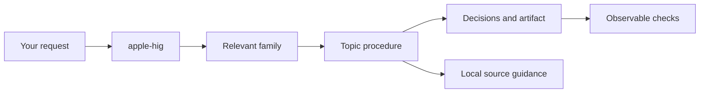

# Apple Human Interface Skills

**Apple’s interface principles, turned into procedures your coding agent can use.**

[](https://github.com/AyushRajSinghParihar/apple-human-interface-skills/actions/workflows/validate.yml)

One `apple-hig` mega-skill routes to **158 topic skills across 13 families**, covering
all articles in the dated current English Apple Human Interface Guidelines
inventory. Every topic contains practical decisions, a concrete output, a worked
correction, and checks—not just a link to an article.

Use it to design, implement, review, or adapt an interface. Procedures preserve
your project’s framework and architecture; examples and pseudocode are framework
agnostic.

## Quick start

Install on the machine **where your agent runs**. For this remote Linux/Mac setup,
run these commands on the **THINKBOOK**; use the Mac when the agent itself runs there.

```bash
git clone https://github.com/AyushRajSinghParihar/apple-human-interface-skills.git
cd apple-human-interface-skills
mkdir -p ~/.agents/skills
skill_link="$HOME/.agents/skills/apple-hig"
if [ -e "$skill_link" ] || [ -L "$skill_link" ]; then
  printf '%s\n' "Inspect the existing installation: $skill_link"
else
  ln -s "$PWD/skills/apple-hig" "$skill_link"
fi
```

Restart or refresh Codex skill discovery, then try:

```text
Use $apple-hig to review this iPad editor. Delete is the default action,
all four buttons have equal prominence, and repeated Publish taps start
multiple uploads. Give us a concrete correction and checks we can execute.
```

For **Claude Code**, install the same complete `skills/apple-hig` folder under
`~/.claude/skills/apple-hig`, then invoke `/apple-hig`. Inspect any existing
installation before replacing it. Claude’s runtime has not been verified here.

A complete folder copy or a project-local installation also works. Preserve all
files, including hidden `.topics` directories. Ordinary use requires no Python,
API key, browser, or authoring cache.

## What the skills actually do

| Task | Expected work |
|---|---|
| Design | Choose an appropriate hierarchy and interaction model; specify states and acceptance scenarios |
| Implement | Make authorized changes in the existing stack and verify what the environment permits |
| Review | Identify evidence-backed problems, consequences, source support, and concrete corrections |
| Adapt | Preserve the product task while applying the target platform’s input, navigation, and presentation conventions |

For example, [Buttons](skills/apple-hig/subskills/apple-hig-menus-and-actions/.topics/apple-hig-buttons/SKILL.md)
distinguishes commands from persistent selection, resolves roles and prominence,
and defines pending, result, and recovery behavior.
[Modality](skills/apple-hig/subskills/apple-hig-presentation/.topics/apple-hig-modality/SKILL.md)
resolves task scope, dismissal, and unsaved work.
[Widgets](skills/apple-hig/subskills/apple-hig-system-experiences/.topics/apple-hig-widgets/SKILL.md)
chooses useful glanceable content and specifies freshness, privacy, and destinations.

Each procedure links to its local source guide and relevant conditional handoffs.
The agent distinguishes inspected evidence from checks that still need a device.

## How routing works



The root and 13 family entry points are discoverable. The 158 topic procedures
load on demand from `.topics/`, keeping initial context small. The installed
bundle contains **172 `SKILL.md` files** in total.

The topic index includes natural-language triggers, so requests can match a
procedure without naming an Apple component or framework. The agent reads the
procedure before its source guide, then follows handoffs for other material
decisions such as accessibility, privacy, or platform adaptation. Paths resolve
from the installed package rather than the shell’s working directory.

| Family | Topics | Coverage |
|---|---:|---|
| Getting started | 9 | Principles, platform conventions, games, device adaptation |
| Foundations | 18 | Accessibility, layout, typography, color, materials, privacy, RTL |
| Patterns | 25 | Flows, accounts, interruption, recovery, feedback, media |
| Content | 4 | Charts, images, text, web content |
| Layout and organization | 10 | Containers, hierarchy, lists, disclosure, adaptation |
| Menus and actions | 12 | Commands, roles, menus, toolbars, ornaments |
| Navigation and search | 5 | Destinations, search scope, state, restoration |
| Presentation | 8 | Task scope, interruption, anchoring, dismissal |
| Selection and input | 11 | Value domains, precision, validation, correction |
| Status | 4 | Progress, values, ratings, Activity goals |
| System experiences | 10 | Surface choice, freshness, privacy, system content |
| Inputs | 13 | Targeting, focus, activation, gestures, alternatives |
| Technologies | 29 | Prerequisites, integration, consent, recovery |

Browse the [complete topic index](skills/apple-hig/references/topic-index.md) or
[platform/task routes](skills/apple-hig/references/platforms-and-tasks.md).

## Coverage and verification

| Area | Verified scope |
|---|---|
| Source coverage | **173 routes / 158 article guides**, with reviewed text and meaningful media accounting; [source report](coverage/REPORT.md) |
| Procedure quality | **158 independent, hash-bound instruction approvals**, covering decisions, artifacts, transformations, verification, applicability, handoffs, and distinctiveness; [package audit](coverage/package-review.json) |
| Installation | Actual Codex CLI **0.164.0** complete-bundle smoke passed **17 checks**, including relocated copy, symlink, paths with spaces, 14-entry discovery, 158 hidden topics, procedure/source reads, and an artifact; [record](coverage/client-integration/symlink-path-spaces-r1/record.json) |
| Tooling | **75 deterministic tests**, plus source and instruction checks in CI |
| Development executions | [Retained traces and artifacts](coverage/behavior/); a full independent comparative grading study was not completed, so these are not an accepted quality benchmark |
| Other environments | Claude runtime, native Apple builds, rendering, VoiceOver interaction, physical input, comfort, and haptics remain unverified |

Coverage means the **dated current English HIG snapshot**, recorded on
2026-10-25. Translations, historical documentation, and complete linked SDK/WWDC
libraries are outside that inventory. The source references and visual explanations
are bundled; raw Apple source exports and downloaded media are not redistributed.

HIG experience guidance does not replace current API documentation. A missing
platform section does not establish support. Source conflicts and unexecuted
checks remain explicit.

## Update and remove

For a symlink installation, update the source checkout and refresh discovery:

```bash
git pull --ff-only
```

Moving or deleting that checkout breaks its installation link. For a copied
installation, replace the complete bundle from a reviewed revision, including
hidden directories.

Inspect a Codex symlink before removing it:

```bash
ls -ld "$HOME/.agents/skills/apple-hig"
readlink "$HOME/.agents/skills/apple-hig"
if [ -L "$HOME/.agents/skills/apple-hig" ]; then
  rm "$HOME/.agents/skills/apple-hig"
fi
```

For Claude Code, substitute `.claude` for `.agents`. Refresh discovery afterward.
If a topic cannot be found, check that the complete bundle was installed and no
same-named skill is taking precedence.

## Maintenance

Python 3.11+ and PyYAML are needed only for authoring checks:

```bash
python3 -m venv .venv
.venv/bin/pip install -r requirements-dev.txt
.venv/bin/python -m unittest discover -s tests -v
.venv/bin/python scripts/hig.py check
.venv/bin/python scripts/hig.py check-skills --instructions-only
```

CI validates source accounting, installed topic ownership, independent instruction
reviews, routing, and links. These checks do not invent semantic approvals.
`check --live` checks upstream drift without rewriting the snapshot. The optional
`check-skills` command without `--instructions-only` also requires independently
graded behavioral evidence; that extended study remains incomplete.

[Authoring research](docs/skill-design.md) · [Source method](docs/source-method.md) ·
[Contributing](CONTRIBUTING.md) · [Development history](docs/operational-progress.md)

## Attribution and license

An independent community project, unaffiliated with Apple. Original code and
guidance are [MIT licensed](LICENSE). Apple documentation, trademarks, and
referenced media remain their owners’ property. The installable bundle includes
its own license copy and source attributions.
