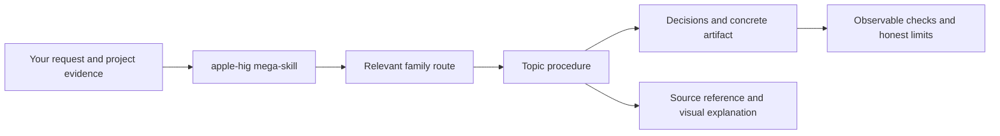

# Apple Human Interface Skills

**Give your agent a procedure for the interface decision in front of it.**

[](https://github.com/AyushRajSinghParihar/apple-human-interface-skills/actions/workflows/validate.yml)

One portable `apple-hig` mega-skill routes to **158 topic procedures** across
**13 families**, backed by the current English Apple Human Interface Guidelines.
Each procedure teaches decisions, a concrete work product, a worked correction,
and observable checks. The detailed source references remain available on demand.

Examples and pseudocode are **framework agnostic**. The agent preserves your
existing framework, architecture, and product requirements.

> The operational topic upgrade is being verified; final outcomes and independent
> grades for the 195-execution release suite are pending. Source coverage and topic
> capability are separate verdicts; the evidence table below reports each one.

## From a request to useful work

```text
Use $apple-hig to review this iPad editor footer. Delete is the default,
all four buttons have equal prominence, and repeated Publish taps start
multiple uploads. Give us a concrete correction and checks we can execute.
```

The workflow inspects the supplied evidence, classifies the commands, resolves
roles and prominence, specifies pending/result/recovery behavior, and produces
an action contract with source-qualified checks. It distinguishes an observed
specification defect from a device test that still needs to happen.

The recorded [artifact evaluations](coverage/behavior/) contain the actual
prompts, file-read traces, outputs, failures, and independent grades. A directory
entry alone is not a passing result; use the verification ledger below.

## What you get

| Request | Work product |
|---|---|
| **Design** a new surface | An implementable hierarchy, interaction/state contract, and acceptance scenarios |
| **Implement** a correction | Authorized changes in the supplied project's stack, with relevant verification |
| **Review** a screen, flow, specification, or code | Evidence-backed findings, consequences, source support, and concrete corrections |
| **Adapt** an experience | A patch or before/after specification that preserves the product task while applying platform differences |

A topic procedure must make a consequential decision. Buttons distinguishes an
immediate command from persistent selection; Modality resolves task scope and
exit behavior; Widgets chooses useful glanceable content and defines freshness,
privacy, and deep links. These procedures link to source details after guiding
how to use them.

## Install in a minute

Install on the machine **where your coding agent runs**. In a remote Linux/Mac
setup, these commands run on the **THINKBOOK**. A copied installation on a Mac
works when the agent itself runs there.

The operational upgrade is being published incrementally on
`feat/operational-topic-skills` while verification continues. The command below
installs that preview; the default branch remains the original reference package
until the release checks pass.

```bash
git clone --branch feat/operational-topic-skills https://github.com/AyushRajSinghParihar/apple-human-interface-skills.git
cd apple-human-interface-skills
mkdir -p ~/.agents/skills
skill_link="$HOME/.agents/skills/apple-hig"
if [ -e "$skill_link" ] || [ -L "$skill_link" ]; then
  printf '%s\n' "Inspect the existing installation: $skill_link"
else
  ln -s "$PWD/skills/apple-hig" "$skill_link"
fi
```

Those are the Codex user-skill paths. The guard leaves an existing file, directory,
or symlink untouched, including a dangling symlink. Restart or refresh skill
discovery if the new skill does not appear.

For Claude Code, use the same complete package in its personal directory:

```bash
mkdir -p ~/.claude/skills
skill_link="$HOME/.claude/skills/apple-hig"
if [ -e "$skill_link" ] || [ -L "$skill_link" ]; then
  printf '%s\n' "Inspect the existing installation: $skill_link"
else
  ln -s "$PWD/skills/apple-hig" "$skill_link"
fi
```

A full folder copy also works. Preserve the whole folder, including its hidden
`.topics` directories. For a project installation, place the complete bundle in
that client's project skills directory. Ordinary skill use needs no Python,
API key, browser, authoring cache, or package-specific runtime.

Confirm discovery by starting your client and asking:

```text
Use $apple-hig to explain which installed topic procedure you would use
for sheet dismissal with unsaved edits. Read it and identify the artifact
and checks it requires.
```

In Claude Code, use `/apple-hig`. The [Codex installation record](coverage/client-integration/symlink-path-spaces/record.json)
identifies the tested client version and package dependencies. That smoke tested
an earlier router revision; a final-router smoke is pending. Claude runtime remains
unverified because the installed client is unauthenticated. Format compatibility
does not establish runtime support for a client that has not been exercised.

[Codex skill documentation](https://learn.chatgpt.com/docs/build-skills) ·
[Claude Code skill documentation](https://code.claude.com/docs/en/skills)

## How routing works



The root and 13 family entry points are discoverable. The 158 topic skills live
under `.topics/` and are loaded explicitly by relative path. This keeps their
full instructions and metadata out of initial discovery on the tested Codex
version. They are real `SKILL.md` procedures, distributed as part of this bundle.

Exact-topic lookup enters the procedure first. The agent then reads its supporting
reference and conditional handoffs. It does not load all 158 topics for a narrow
question. Paths resolve from the installed package, independent of the shell's
working directory.

Routing also uses the meaning of the request. The topic index includes each
procedure's trigger description, so everyday product tasks can match guidance
without naming an Apple component or framework. The agent reads the owning family
and matching procedure, then adds procedures for the task's other material
decisions, such as platform adaptation, privacy, or accessibility. Selecting a
technology topic does not require replacing the project's framework.

| Family | Decisions covered | Topics |
|---|---|---:|
| Getting started | Platform conventions, principles, games, device adaptation | 9 |
| Foundations | Accessibility, hierarchy, typography, color, materials, privacy, RTL | 18 |
| Patterns | End-to-end flows, interruption, recovery, accounts, media, feedback | 25 |
| Content | Charts, images, text, and embedded web content | 4 |
| Layout and organization | Information hierarchy, containers, selection, adaptation | 10 |
| Menus and actions | Commands, roles, discoverability, menus, toolbars, ornaments | 12 |
| Navigation and search | Destinations, search scope, state, and restoration | 5 |
| Presentation | Task scope, interruption, anchoring, and dismissal | 8 |
| Selection and input | Value domains, precision, validation, and correction | 11 |
| Status | Honest progress, values, ratings, and Activity goals | 4 |
| System experiences | Surface choice, freshness, privacy, and system-owned content | 10 |
| Inputs | Targeting, focus, activation, reserved behaviors, and alternatives | 13 |
| Technologies | Capability prerequisites, integration, consent, and recovery | 29 |

Browse the [topic procedures](skills/apple-hig/references/topic-index.md) or
[platform/task routes](skills/apple-hig/references/platforms-and-tasks.md).

## Try a real task

```text
Use $apple-hig to fix this form's validation and cancellation behavior.
Inspect the current implementation and keep our existing framework.
```

```text
Use $apple-hig to adapt this media browser from iPad to Apple TV.
Preserve selection and the product task; change input and navigation
where needed. Patch the supplied specification.
```

```text
Use $apple-hig to audit this Arabic chart editor. Separate findings
supported by the supplied screenshot/code from runtime checks we still need.
```

## Verification: five different claims

| Area | Evidence and boundary |
|---|---|
| **Source fidelity** | [Dated source report](coverage/REPORT.md): 173 routes, 158 article guides, independently reviewed text and meaningful media |
| **Instruction quality** | [Capability inventory](coverage/capabilities.json) and independent topic-review records; a source approval does not approve a new procedure |
| **Agent behavior** | [Recorded executions](coverage/behavior/): 158 topic tasks, 24 repeated stress executions, and 13 matched old-package controls are the release target; only graded, current evidence counts |
| **Installation and discovery** | Actual Codex client tests for copied/symlinked packages, visible family routes, and on-demand topic reads; separate from static link tests |
| **Apple runtime and hardware** | Native builds, rendering, VoiceOver interaction, physical input, and haptics require suitable Apple environments; Linux artifact checks cannot establish them |

Behavioral graders assess the actual artifact against source-specific criteria.
The release requires at least 8/10, no critical unsupported advice or invented
observation, and the required seeded findings for review fixtures. Failed attempts
remain recorded. Repeated stress runs check consistency, not statistical reliability.

The source boundary is the **dated current English HIG**. Translations, archives,
and full linked SDK/WWDC libraries are outside that denominator. Source conflicts
are retained explicitly. HIG experience guidance does not substitute for current
API documentation, and a missing platform section does not prove support.

## Update or remove

For a symlink installation, run this from the source checkout, then refresh client
discovery. Moving or deleting that checkout breaks its installation link.

```bash
git pull --ff-only
```

If the checkout is pinned to a tag or detached commit, select a newer reviewed
revision instead of pulling. A pull updates only to commits already published
on the checkout's configured upstream branch.

For a copied installation, replace the complete bundle from a reviewed revision;
do not update only the root file or omit hidden directories. The installed root
path is preserved across this upgrade.

To remove a Codex symlink installation, inspect its destination first:

```bash
ls -ld "$HOME/.agents/skills/apple-hig"
readlink "$HOME/.agents/skills/apple-hig"
```

After confirming that it is the intended installation link, remove only the link:

```bash
if [ -L "$HOME/.agents/skills/apple-hig" ]; then
  rm "$HOME/.agents/skills/apple-hig"
fi
```

For Claude Code, substitute `.claude` for `.agents`. Refresh client discovery
after removal. Keep the source checkout if you want to retain the research and
evidence. For a copied folder, inspect it before removing the selected installation.

If routing fails, check that the entire bundle exists, hidden `.topics` files were
preserved, discovery was refreshed, and another same-named skill is not taking
precedence. Never solve a missing-topic error by assuming the source is unsupported.

## Maintain the package

Maintainers use Python 3.11 or later; PyYAML supplies strict frontmatter parsing.

```bash
python3 -m venv .venv
.venv/bin/pip install -r requirements-dev.txt
.venv/bin/python -m unittest discover -s tests -v
.venv/bin/python scripts/hig.py check
.venv/bin/python scripts/hig.py check-skills
```

`check` verifies source accounting and existing article/media approvals.
`check-skills` verifies operational ownership, instruction reviews, routing, and
current behavioral evidence. Neither checker can invent a semantic approval.

Use `scripts/hig.py check --live` to detect upstream source/media drift without
rewriting the tracked snapshot. Use `discover` and `report` for a deliberate
source refresh. New or changed guidance requires appropriate independent review.
Behavioral executions use the maintainer's existing authenticated Codex client;
they are not a dependency of installing or reading the skill.

[Implementation plan](docs/operational-skills-plan.md) ·
[Skill authoring research](docs/skill-design.md) ·
[Source method](docs/source-method.md) · [Contributing](CONTRIBUTING.md)

## Attribution and license

An independent community project, unaffiliated with Apple. Original code and
guidance are [MIT licensed](LICENSE); the installable bundle retains its own copy
of the license. Apple documentation, trademarks, and referenced media remain their
owners' property. Raw Apple source exports and downloaded assets are not bundled.
